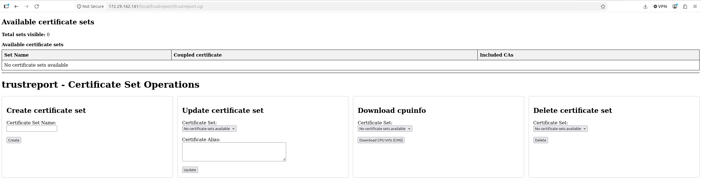
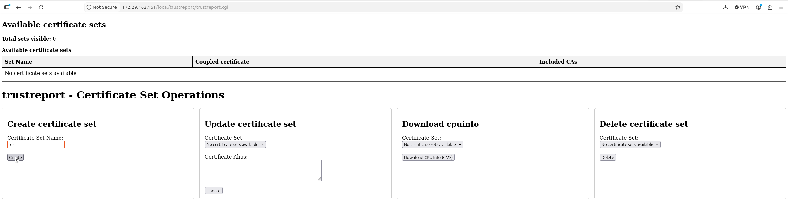
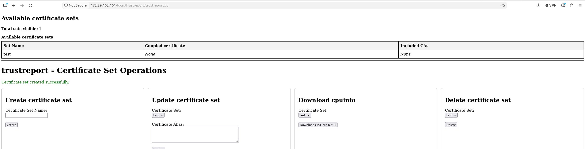
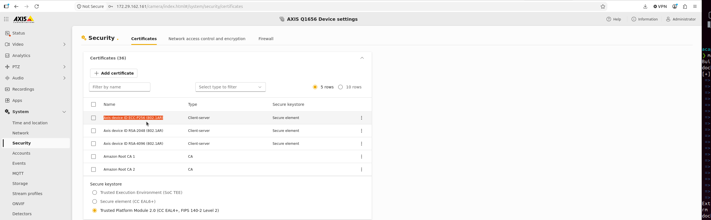
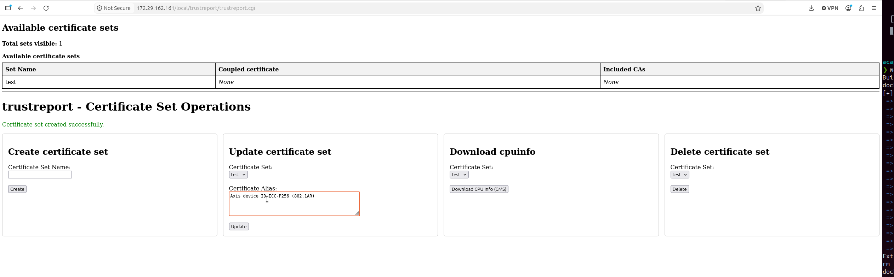
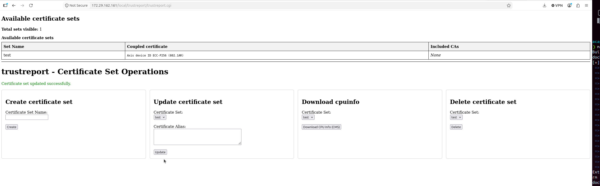
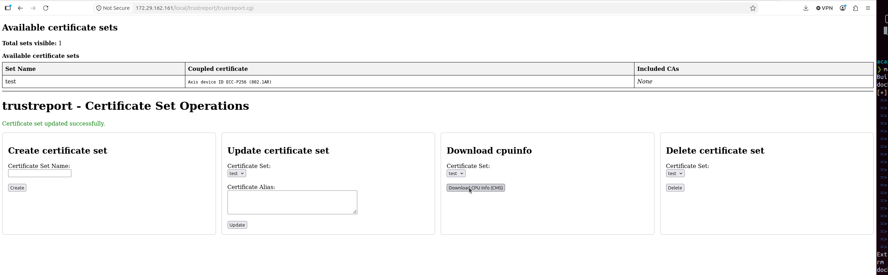

*Copyright (C) 2026, Axis Communications AB, Lund, Sweden. All Rights Reserved.*

# Signing device data with hardware-protected keys (Certificate1 API)

This example shows how to use the new Certificate1 API to use certificates with
hardware backed private keys.

Axis devices have had the hardware and software support to securely store
private keys inside hardware modules like TEE (Trusted Execution Environment)
or TPM (Trusted Platform Module) for a long time (see
[Edge Vault](https://www.axis.com/solutions/edge-vault)).
However, this support was not exposed to ACAP applications. Certificate1 is the
first step to expose this functionality to ACAP applications.

In its current form, Certificate1 allows an ACAP application to make use of any
private key currently stored in the system or that would later be added by an
administrator.

## Project structure

These instructions will guide you on how to execute the code. Below is the
structure and scripts used in the example:

```sh
certificate-set-management
├── app
│   ├── certset.c
│   ├── certset.h
│   ├── trustreport.c
│   ├── trustreport_fcgi.c
│   ├── trustreport_fcgi.h
│   ├── trustreport_templates.c
│   ├── trustreport_templates.h
│   ├── LICENSE
│   ├── Makefile
│   └── manifest.json
├── Dockerfile
└── README.md

- **app/certset.c** - Implementation of the Certificate1 D-Bus API.
- **app/trustreport.c** - Main application.
- **app/trustreport_fcgi.c** - HTTP server implementation.
- **app/trustreport_templates.c** - HTTP templates.
- **app/LICENSE** - Text file which lists all open source licensed source code distributed with the application.
- **app/Makefile** - Makefile containing the build and link instructions for building the ACAP application.
- **app/manifest.json** - Defines the application and its configuration.
- **Dockerfile** - Docker file with the specified Axis toolchain and API container to build the example specified.
- **README.md** - Step by step instructions on how to run the example.

## Application description

This example ACAP application implements a simple HTTP server frontend so an
operator can freely choose which certificates to use for signing operations.
Once the certificate is chosen, the operator can select to download a simple
signed CMS packages containing the /proc/cpuinfo file of the camera.

A CMS in this context is a Cryptographic Message Syntax
([CMS](https://datatracker.ietf.org/doc/html/rfc5652))
package. This CMS would contain a signature that only the holder of the private
key could generate, but anyone with the public key could verify. The public key
is contained inside the certificate which can be freely shared.

This ACAP application can only be used with AXIS OS 13.x and later.

## Build the application

Standing in your working directory run the following commands:

> [!NOTE]
>
> - You need to
>   [Set your vendorId in the manifest](../DEV.md#set-your-vendorid-in-the-manifest)
>   in order to run the examples unsigned with
>   [Developer Mode](https://developer.axis.com/acap/get-started/set-up-developer-environment/set-up-device-advanced/#developer-mode).
> - Depending on the network your local build machine is connected to, you may need to add proxy
>   settings for Docker. See
>   [Proxy in build time](https://developer.axis.com/acap/develop/proxy/#proxy-in-build-time).

```sh
docker build --tag <APP_IMAGE> .
```

<APP_IMAGE> is the name to tag the image with, e.g., trustreport:1.0

Default architecture is **armv7hf**. To build for **aarch64** it's possible to
update the *ARCH* variable in the Dockerfile or to set it in the Docker build
command via build argument:

```sh
docker build --build-arg ARCH=aarch64 --tag <APP_IMAGE> .
```

Copy the result from the container image to a local directory build:

```sh
docker cp $(docker create <APP_IMAGE>):/opt/app ./build
```

The working dir now contains a build folder with the following files:

```sh
certificate-set-management
├── app
│   ├── certset.c
│   ├── certset.h
│   ├── trustreport.c
│   ├── trustreport_fcgi.c
│   ├── trustreport_fcgi.h
│   ├── trustreport_templates.c
│   ├── trustreport_templates.h
│   ├── LICENSE
│   ├── Makefile
│   └── manifest.json
├── build
│   ├── certset.c
│   ├── certset.h
│   ├── trustreport.c
│   ├── trustreport_fcgi.c
│   ├── trustreport_fcgi.h
│   ├── trustreport_templates.c
│   ├── trustreport_templates.h
│   ├── debug
│   │   └── trustreport
│   ├── trustreport*
│   ├── trustreport_1_0_0_armv7hf.eap
│   ├── trustreport_1_0_0_LICENSE.txt
│   ├── LICENSE
│   ├── Makefile
│   └── manifest.json
├── Dockerfile
└── README.md

- **build/trustreport*** - Application executable binary file.
- **build/trustreport_1_0_0_armv7hf.eap** - Application package .eap file.
- **build/trustreport_1_0_0_LICENSE.txt** - Copy of LICENSE file.
- **build/manifest.json** - Defines the application and its configuration.
- **build/package.conf** - Defines the application and its configuration.
- **build/package.conf.orig** - Defines the application and its configuration, original file.
- **build/param.conf** - File containing application parameters.

## Install and start the application

Browse to the application page of the Axis device:

```sh
http://<AXIS_DEVICE_IP> /index.html#apps
```

- Click on the tab `Apps` in the device GUI
- Click `(+ Add app)` button to upload the application file
- Browse to the newly built ACAP application, depending on architecture:
  - `trustreport_1_0_0_aarch64.eap`
  - `trustreport_1_0_0_armv7hf.eap`
- Click `Install`
- Run the application by enabling the `Start` switch

## Expected Output

Open the application CGI by either clicking on the Open button in the
application list or by browsing to:

```sh
http://<AXIS_DEVICE_IP> /local/trustreport/trustreport.cgi
```



First create an empty certificate set by typing in a set name and clicking on
the `Create` button.




Once it is created, you need to add a certificate to the set. You can look at
the available certificate by looking at the certificate list in ADA:



Write down the chosen certificate alias that you wish to use for signing. By
default newer devices contains IDEVID certificates like:
"Axis device ID ECC-P256 (802.1AR)"

You can can also generate generate a separate private key and certificate. Look
at the Certificate Creation section below for more information.

Write down the chosen certificate alias and click on update:




Now that you have a certificate set that is populated with a certificate, you
can actually use it for signing operations.

Download the signed cms package, verify and extract the content:



```sh
curl -o cpuinfo.pem 'https://<AXIS_DEVICE_IP> /local/trustreport/trustreport.cgi?action=sign_cpuinfo&certset_name=TrustReport'

openssl cms -in cpuinfo.pem -verify  -CAfile chain.pem -out cpuinfo.txt
cat cpuinfo.txt
processor : 0
BogoMIPS : 50.00
Features : fp asimd evtstrm aes pmull sha1 sha2 crc32 atomics fphp asimdhp cpuid asimdrdm lrcpc dcpop asimddp
CPU implementer : 0x41
CPU architecture: 8
CPU variant : 0x2
CPU part : 0xd05
CPU revision : 0

processor : 1
BogoMIPS : 50.00
Features : fp asimd evtstrm aes pmull sha1 sha2 crc32 atomics fphp asimdhp cpuid asimdrdm lrcpc dcpop asimddp
CPU implementer : 0x41
CPU architecture: 8
CPU variant : 0x2
CPU part : 0xd05
CPU revision : 0

...

```

## Certificate Creation

The Certificate1 API allows ACAP applications to make use of existing private
keys and certificates. However, it does not provide any functionality to create
them. The creation of private keys and certificates currently requires a VAPIX
admin user to create them. Certificate creation is described in greater detail
in the official [Axis VAPIX Documentation](https://developer.axis.com/vapix/device-configuration/certificate-management/).

To help developers get quickly started we will show a quick example here on how
to create a new private key and certificate using the VAPIX API.

In the first step we need to generate the private key and self-signed
certificate.

```bash
$ curl --anyauth -u ${USER}:${PASS} https://<AXIS_DEVICE_IP> /config/rest/cert/v1/create_certificate -k -H 'Content-Type: application/json' -d '{
    "data": {
        "alias": "CustomCert",
        "key_type": "EC-P256",
        "keystore": "TEE0",
        "subject": "C=SE,CN=example.com",
        "subject_alt_names": [
            "DNS:example.com"
        ],
        "valid_from": '$(date +%s)',
        "valid_to": '$(date --date="+1 year" +%s)'
    }
}'

{
  "status": "success"
}
```

You can double check that the certificate was create by trying to list it:

```bash
$ curl --anyauth -u ${USER}:${PASS} 'https://<AXIS_DEVICE_IP> /config/rest/cert/v1/certificates/CustomCert' -k
{
  "status": "success",
  "data": {
    "alias": "CustomCert",
    "certificate": "-----BEGIN CERTIFICATE-----\nMIIBWDCB/6ADAgECAgsAkbTZyDdGGxfTPjAKBggqhkjOPQQDAjAjMQswCQYDVQQG\nEwJTRTEUMBIGA1UEAwwLZXhhbXBsZS5jb20wHhcNMjYwNzI5MDg0NTM5WhcNMjcw\nNzI5MDg0NTM5WjAjMQswCQYDVQQGEwJTRTEUMBIGA1UEAwwLZXhhbXBsZS5jb20w\nWTATBgcqhkjOPQIBBggqhkjOPQMBBwNCAARlsWJgo27gxI/MbpBj9CG7UkysV7Al\n/NTucs74bUSBfTc6itvzuSwqpJRMdCBBqwrUISE7Wcmlo5SwKFKbOi5VoxowGDAW\nBgNVHREEDzANggtleGFtcGxlLmNvbTAKBggqhkjOPQQDAgNIADBFAiBMUzr4ooBk\n7NDi00ePJ6VP6c3suZdBTUIUfEtnAB0UjwIhAOB/zG5+lAIXQxjdZaWyMceIisyt\nTAunVeUiPjj7zS2i\n-----END CERTIFICATE-----\n",
    "keystore": "TEE0"
  }
}
```

At this stage you can already use the newly create certificate for signing
operations. The certificate is self-signed and not trusted by any CA. But if
you do not use the certificate (like WebRTC for example) you can already
proceed.

If you do need to replace the self-signed certificate, you can retrieve a CSR
and then upload a signed certificate from a CA to replace the previous
self-signed certificate. We will not describe how to generate the certificate
here for brevity.

It is possible to retrieve the CSR for our new key with a simple VAPIX API call
(note that we need to use the same alias in the URL as we used when creating
the certificate):

```bash
$ curl --anyauth -u ${USER}:${PASS} "https://<AXIS_DEVICE_IP> /config/rest/cert/v1/certificates/CustomCert/get_csr" -k -H 'Content-Type: application/json' -d '{"data":{}}'
{
  "status": "success",
  "data": "-----BEGIN CERTIFICATE REQUEST-----\nMIIBBzCBrgIBADAjMQswCQYDVQQGEwJTRTEUMBIGA1UEAwwLZXhhbXBsZS5jb20w\nWTATBgcqhkjOPQIBBggqhkjOPQMBBwNCAARlsWJgo27gxI/MbpBj9CG7UkysV7Al\n/NTucs74bUSBfTc6itvzuSwqpJRMdCBBqwrUISE7Wcmlo5SwKFKbOi5VoCkwJwYJ\nKoZIhvcNAQkOMRowGDAWBgNVHREEDzANggtleGFtcGxlLmNvbTAKBggqhkjOPQQD\nAgNIADBFAiEAixomBuF2r2Xp5Fb60xuwMG64Imf3iaPTyBRFvSNqZeECIB4xrKqu\nhnFXSHGiROmWRoc/CRr+MDx9wdTQ5zyt+nCh\n-----END CERTIFICATE REQUEST-----\n"
}

# If you have jq you can directly save the CSR to a file in one command
$ curl --anyauth -u ${USER}:${PASS} "https://<AXIS_DEVICE_IP> /config/rest/cert/v1/certificates/CustomCert/get_csr" -k -H 'Content-Type: application/json' -d '{"data":{}}'| jq -r '.data' > mycsr.pem
```

Save the CSR to a file and send it to your CA for signing. Once you get a
signed certificate in PEM format you can upload it to the device using another
VAPIX API call:

```bash
$ curl --anyauth -u "${USER}:${PASS}" "https://<AXIS_DEVICE_IP> /config/rest/cert/v1/certificates/CustomCert" -k -H 'Content-Type: application/json' -X PATCH -d "$(jq -n --rawfile cert cert.pem '{data: {certificate: $cert}}')"
{
  "status": "success"
}
```

For details around key types, keystores, importing existing keys, please
consult the official [Axis VAPIX
Documentation](https://developer.axis.com/vapix/device-configuration/certificate-management/).

## License

**[MIT](../LICENSE)**
